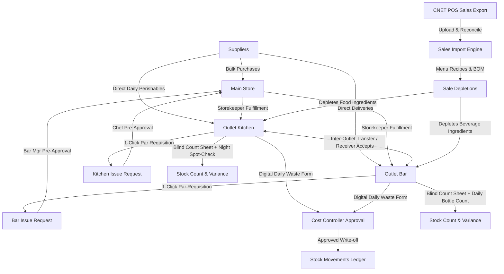

# Prime F&B Cost Control — Comprehensive System Analysis & Materials Control (MC) Architecture

## 1. Executive Summary & Purpose

### What This Project Is
**Prime F&B Cost Control** is a specialized Food & Beverage cost-control and inventory management system designed for **Prime Hospitality Business Group** (Addis Ababa, Ethiopia; currency: Ethiopian Birr - ETB). 

It replaces error-prone, single-user Excel workbooks with a robust, multi-tenant web application focused on four fundamental questions:
1. **What does it cost to make what we sold?** (Theoretical Cost of Goods Sold)
2. **What should our stock levels be?** (Theoretical Book Stock on Hand)
3. **What is our actual physical stock?** (Physical Inventory Count)
4. **Where is the difference, and why?** (Variance, Waste, Theft, Portion Drift, Spoilage)

### Relationship to Materials Control (MC)
This system is fundamentally modeled on the principles of **Materials Control (MC)** (the industry-standard hospitality inventory and food costing software used by international hotels and restaurant chains, such as Oracle/Agilysys MC). In fact, the project repository contains over 25 official Materials Control standard operating procedure (SOP) manuals in its `reference/` directory.

However, full enterprise Materials Control is notoriously heavy, bloated with complex procurement chains, general ledger postings, complex tax matrices, and multi-tier corporate hierarchies that overwhelm single properties or small restaurants with a kitchen and bar. 

**This project distills the core operational power of Materials Control into a lean, fast, intuitive system tailored specifically for kitchen and bar operations.**

---

## 2. Materials Control (MC) Comparison Matrix

| Feature / Capability | Enterprise Materials Control (MC) | This Project (Kitchen & Bar Tailored) | Rationale & Practical Fit |
| :--- | :--- | :--- | :--- |
| **Stock On Hand Storage** | Period balance tables & inventory masters | **Append-only ledger (`stock_movements`)**. Stock on hand is ALWAYS computed: `SUM(qty_delta)`. | Zero balance corruption, tamper-proof audit trail, simple recovery. |
| **Costing Method** | Moving Weighted Average / FIFO / Standard Cost | **Moving Weighted Average per Store & Item**. Recalculated dynamically on receipts. | Standard for F&B in hospitality; avoids complex FIFO lot-tracking while maintaining accurate valuation. |
| **Recipe Structure** | Multi-level Bill of Materials (BOM), shrinkage, yield % | **Recursive tree (Menu items + Sub-recipes / Batches)**. | Essential for kitchen prep (e.g. burger buns, sauces, niter kibbeh). |
| **Receiving Workflow** | Central Receiving Bay / Loading Dock Only | **Hybrid Receiving**: Bulk goods enter Main Store; daily perishables (meat/veg) and bar items can receive directly. | Small restaurants don't have separate loading dock staff for daily fresh market deliveries. |
| **Requisition / Issuing** | Multi-stage approval (HOD -> Cost Control -> Store -> Receiving) | **Chef/Bar Manager Pre-Approval -> Storekeeper Fulfillment**. | Enforces department head accountability before stock leaves the warehouse. |
| **Inter-Outlet Transfers** | Full formal document with dual department approvals | **Sending Outlet Initiates -> Receiving Outlet / Controller Accepts**. | Immediate accountability when Bar borrows lemons/mint from Kitchen or Kitchen borrows cooking wine. |
| **Par Stock Replenishment** | Complex replenishment modules | **1-Click "Fill to Par"**: Auto-calculates `Order Qty = Par - On Hand` (omits full items) + Min Par alerts. | Cuts daily ordering time from 30 minutes to 30 seconds. |
| **Waste & Leakage Logging** | Physical clipboard logs re-keyed by controller | **Digital Shift Entry -> Controller 1-Click Signoff**. | Replaces lost paper sheets while preserving financial controller oversight. |
| **Physical Stock Take** | Full printed sheets; blind vs visible | **Blind Count Sheets** (blanks expected qty to prevent cheating) + Daily Night Bar/Meat Closing Sheet. | Industry-standard anti-theft control for bars and high-value steaks/seafood. |
| **Reporting & Analytics** | Standalone reporting engine | **Full F&B Cost Reconciliation** (Opening + Purchases - Closing = Cost %) + **4-Quadrant Menu Engineering Matrix**. | Identifies which dishes are Stars, Plowhorses, Puzzles, or Dogs. |
| **General Ledger / Accounting**| Full Accounts Payable, Accounts Receivable, GL, Bank Rec | **Explicitly Out of Scope**; exportable data for third-party accounting (e.g., Peachtree). | Eliminates ERP bloat; focuses strictly on operational cost control. |

---

## 3. Core Architectural Principles & Invariants

The project is governed by strict, non-negotiable architectural rules enforced at the database and application levels:

1. **Stock on hand is never a stored column:**
   - There is no `stock_on_hand` column on `items` or `stores`.
   - Every movement is an immutable row in `stock_movements`. Stock is `SUM(qty_delta)`.
2. **Immutability & Forward-Only State:**
   - Once posted, documents (purchases, transfers, counts, issue requests, sales imports) cannot be modified or deleted.
   - Corrections must be executed as explicit reversal movements.
3. **Effective-Dated Recipe & Ingredient Costs:**
   - Ingredient prices change continuously due to local inflation.
   - Changing ingredient costs today does not rewrite history or retroactively distort previous months' cost-of-sales reports.
4. **Exact Decimal Precision (No Float Math):**
   - Quantities: `numeric(18,6)`
   - Money: `numeric(18,2)`
   - POS source data: `numeric(18,4)` (preserves CNET 3-decimal rounding)
   - Calculated with `decimal.js` using `ROUND_HALF_UP`, matching PostgreSQL rounding.
5. **Best-Effort Sales Depletion:**
   - Sales revenue **always posts**.
   - Depletion only occurs for articles mapped to active recipes. Uncosted articles are flagged loudly as warnings, never blocking revenue or silently disappearing.
6. **Multi-Tenancy & Store Scoping:**
   - Every entity carries `tenant_id`. Users are scoped either as `admin` or assigned to a specific `store_id` (Main Store, Kitchen, Bar).
7. **Zero-Config Database Portability:**
   - Runs locally in-process via **PGlite** (PostgreSQL compiled to WebAssembly running against `.pgdata/`) without requiring an external DB installation.
   - Switches automatically to standard production PostgreSQL when `DATABASE_URL` is set.

---

## 4. Technology Stack

- **Runtime & Framework:** Node.js v24+, Next.js 16.3.0 (Turbopack, React 19, Server Actions)
- **Database Engine:** PGlite 0.5.4 (WASM PostgreSQL) for local development/testing; `pg` (Node-Postgres) for production.
- **Styling & UI:** Tailwind CSS v4, Lucide Icons, `next-themes` (Dark/Light mode support).
- **Spreadsheet / File Engine:** `xlsx` (SheetJS) for parsing CNET sales exports.
- **Math Engine:** `decimal.js` for arbitrary-precision fixed-point math.
- **Testing:** Vitest (101 unit & integration tests covering recipes, parsing, depletions, movements, and reconciliation).

---

## 5. Database Schema & Migration Breakdown

The database is built on 15 ordered migrations:

1. `001_core.sql`:
   - `tenants`, `branches`, `stores` (`kind`: `main`, `kitchen`, `bar`, `storage`).
   - `item_categories`, `items` (UOM, purchase price, is_active).
   - `store_item_levels` (minimum par, maximum par, reorder alert thresholds per store).
2. `002_menu_and_recipes.sql`:
   - `menu_items`: sellable products (food, beverage, retail).
   - `recipes`: header for menu items and sub-recipes (`batch_yield_qty`, `batch_yield_uom`).
   - `recipe_lines`: hierarchical ingredients linking to either an `item` or another `recipe` (sub-recipe).
   - `pos_item_map`: maps POS article codes to system menu items, tracks `counts_as_sale` and `depletes`.
   - `pos_category_store_map`: routes POS categories to the responsible outlet store (Kitchen vs. Bar).
3. `003_stock.sql`:
   - `stock_movements`: central ledger recording every quantity and cost delta.
   - Movement types: `receipt`, `issue_in`, `issue_out`, `transfer_in`, `transfer_out`, `sale_depletion`, `waste`, `comp`, `staff_meal`, `count_adj`, `return_to_supplier`.
   - `movement_sort_rank`: ensures same-day receipts are prioritized before same-day depletions to preserve moving average pricing.
4. `004_sales.sql`:
   - `sales_imports`: batch header for imported POS data (`period_start`, `period_end`, reconciliation status).
   - `sales_lines`: individual article rows from the POS with net sales, VAT, service charges.
   - `sales_import_issues`: validation issues log (`parse`, `reconciliation`, `coverage`, `unmapped_article`).
5. `005_counts.sql` & `007_counts_and_reporting.sql`:
   - `stock_counts` & `stock_count_lines`: physical inventory counts.
   - `v_stock_count_variance`: view calculating theoretical stock at count time vs. physical count, deriving variance quantity, variance value in ETB, and status (`OK`, `REVIEW`, `INVESTIGATE`).
6. `006_recipe_costing.sql`:
   - PostgreSQL recursive CTE function `recipe_cost()` calculating dynamic recipe costs down to raw materials.
7. `008_auth.sql` & `015_user_permissions.sql`:
   - `users`: email, password hash, role (`admin`, `store_user`), associated `store_id`, and JSONB `permissions`.
8. `009_issue_requests.sql`:
   - Requisition workflow (`issue_requests`, `issue_request_lines`) from kitchen/bar to main store.
9. `010_purchases.sql` & `014_purchase_returns.sql`:
   - Supplier receiving register (`purchases`, `purchase_lines`), status trigger (`draft -> posted -> reversed`).
10. `011_transfers.sql`:
    - Direct inter-store stock transfers (`from_store_id`, `to_store_id`).
11. `012_suppliers.sql`:
    - Supplier master register linked to purchases.
12. `013_purchase_requests.sql`:
    - Internal purchase requisition requests before PO/purchase generation.

---

## 6. Functional Workflows

---

## 7. Current Application Pages

- `/`: **Overview** — High-level KPIs (POS articles, active recipes, stock movements, latest import, recipe cost previews).
- `/dashboard`: **Cost Control Dashboard** — Food vs. Beverage cost of sales %, gross margins, top sellers by quantity/revenue, and coverage curves.
- `/import` & `/import/[id]`: **Sales Import** — Excel upload, reconciliation audit, issue resolution, and depletion posting.
- `/ledger`: **Stock Ledger** — Searchable, filterable audit log of every movement with running balances per store and item.
- `/counts` & `/counts/[id]`: **Stock Taking** — Count sheet creation, variance review, and posting.
- `/variance`: **Discrepancy Investigation** — Items ranked by financial loss / variance value.
- `/purchases` & `/purchases/[id]`: **Receiving Register** — Purchase entry, item line costs, and reversal controls.
- `/purchase-requests`: **Purchase Requisitions** — Outlet purchasing requests.
- `/requests` & `/requests/[id]`: **Store Issue Requests** — Internal requisition and fulfillment.
- `/transfers` & `/transfers/[id]`: **Inter-Outlet Transfers** — Moving stock directly between Kitchen and Bar.
- `/recipes`: **Recipe Costing** — Live ingredient and portion costing calculations.
- `/setup/*`: **Master Data** — Administrative management of Tenants, Branches, Stores, Categories, Items, Par Levels, POS Mappings, Suppliers, and Users.
